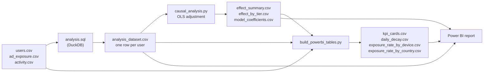

# Beyond the Click: A Causal Impact Analysis of Ad Exposure on User Engagement


A paid ad campaign was shown to some users and not others, but the targeting was not random. This project estimates how much of the extra engagement the ad actually caused, and how much came from the campaign targeting users who were already more active.

**Headline result:** exposed users logged **+10.31 more sessions** in the 7 days after exposure, but after adjusting for pre-campaign behaviour the estimated ad effect is **+3.64 sessions** (95% CI 3.35 to 3.92). About 65% of the raw gap came from who was targeted, not from the ad.


## Table of contents

1. [At a glance](#at-a-glance)
2. [Problem statement](#problem-statement)
3. [Key findings](#key-findings)
4. [Key features](#key-features)
5. [Tech stack](#tech-stack)
6. [Workflow](#workflow)
7. [Methodology](#methodology)
8. [Power BI report](#power-bi-report)
9. [Repository structure](#repository-structure)
10. [Getting started](#getting-started)
11. [Validation](#validation)
12. [Assumptions and limitations](#assumptions-and-limitations)
13. [Future improvements](#future-improvements)
14. [Data and privacy](#data-and-privacy)
15. [Author](#author)

## At a glance

| | |
|---|---|
| **Question** | Did ad exposure cause higher app engagement? |
| **Outcome** | Total app sessions from the exposure date through exposure date + 6 days |
| **Data** | 5,000 users, 215,000 daily activity rows (43 days per user), 2,825 exposed (56.5%) |
| **Core difficulty** | Exposure was not randomised. Targeting favoured users who already looked more likely to engage |
| **Method** | Leakage-safe feature build in SQL, then regression adjustment (OLS with robust standard errors) in Python |
| **Deliverables** | SQL pipeline, Python analysis, Power BI report (`.pbix` and PDF export), interactive HTML version, this documentation |

## Problem statement

The marketing team ran a two-week campaign (exposure dates 1 to 14 February 2026) to promote a new feature, and wants to know whether exposure caused higher engagement.

A direct comparison of exposed and unexposed users is misleading. Before any ad ran, exposed users already averaged 82.6 sessions in the previous 28 days against 57.8 for unexposed users. A naive comparison mixes that head start with any real ad effect. This project separates the two as far as the available data allows.

## Key findings

### 1. The naive comparison overstates the effect by about 3x

| Estimate | Value |
|---|---|
| Average sessions in 7 days after exposure, exposed | 25.64 |
| Average sessions in 7 days after exposure, unexposed | 15.32 |
| **Naive difference** | **+10.31 sessions** |
| **Regression-adjusted effect** | **+3.64 sessions** (robust SE 0.145, 95% CI 3.35 to 3.92, p < 0.001) |
| Gap removed by adjustment | 6.68 sessions (about 65% of the naive gap) |

The adjusted model has an R-squared of 0.812.

### 2. The two groups were not comparable before the campaign

Averages measured strictly before the exposure date:

| Pre-period metric | Unexposed | Exposed |
|---|---|---|
| Sessions, 7 days before | 15.81 | 23.42 |
| Sessions, 28 days before | 57.83 | 82.59 |
| Active days, 28 days before | 22.73 | 25.21 |
| Prior engagement score | 45.60 | 59.47 |


### 3. The adjusted effect is smaller for the least active users

Users were split into three equal-sized groups (terciles) by their sessions in the 28 days before exposure, and the same model was fitted within each group.

| Pre-period activity tier | Users | Adjusted effect (sessions) | Robust SE |
|---|---|---|---|
| Low | 1,672 | 2.32 | 0.19 |
| Mid | 1,665 | 4.46 | 0.22 |
| High | 1,663 | 4.23 | 0.35 |


### 4. The unadjusted gap narrows across the week

The average daily gap in sessions between exposed and unexposed users falls from 1.66 on day 0 to 1.27 on day 6, a decline of about 23%. This is a descriptive, unadjusted comparison, so it should be read as a pattern worth investigating, not as a causal decay estimate.


### 5. Targeting was skewed by device and country

| Device | Exposure rate | | Country | Exposure rate |
|---|---|---|---|---|
| iOS | 62.8% | | US | 59.5% |
| Android | 51.1% | | CA | 51.6% |
| Web | 44.5% | | UK | 49.6% |
| | | | AU | 47.9% |


## Key features

- **Leakage-safe feature engineering.** Predictors are computed only from days before the exposure date. The outcome uses only the exposure date and the six days after it.
- **Naive and adjusted estimates side by side**, so the size of the selection bias is visible.
- **Covariate balance check** that shows why the naive estimate cannot be trusted.
- **Heterogeneity check** that estimates the effect separately for low, mid and high prior-activity users.
- **Robust standard errors** (HC1) on every regression.
- **Reproducible pipeline.** Re-running the three scripts regenerates the dataset, the model outputs and the Power BI tables.
- **Portfolio-ready report** with six Power BI pages, each with a one-sentence takeaway.

## Tech stack

| Area | Tools |
|---|---|
| Data transformation | SQL (DuckDB), run directly on the CSV files |
| Statistical analysis | Python 3, pandas, statsmodels (OLS with HC1 robust errors) |
| Reporting | Power BI Desktop |
| Interactive version | Static HTML with Chart.js loaded from a CDN |
| Editor | VS Code |

## Workflow



1. **`analysis.sql`** loads the three source files, builds the outcome and the pre-period features, joins them to user attributes, and writes `analysis_dataset.csv`. It also prints the naive comparison and the balance check.
2. **`causal_analysis.py`** fits the adjustment model, the per-tier models, and writes the effect tables.
3. **`build_powerbi_tables.py`** builds the small summary tables used by the report.
4. **Power BI** loads the CSVs and presents the results.

## Methodology

### Input data

| File | Columns | Grain |
|---|---|---|
| `users.csv` | `user_id`, `signup_date`, `country`, `device_type`, `prior_engagement_score` | One row per user |
| `ad_exposure.csv` | `user_id`, `exposed` (0 or 1), `exposure_date` | One row per user |
| `activity.csv` | `user_id`, `date`, `sessions` | One row per user per day |

Every user, exposed or not, has an `exposure_date`. It is used as the index date for the pre and post windows. Each user has 43 days of activity, from 28 days before to 14 days after the index date.

### Variables

| Variable | Definition |
|---|---|
| `sessions_post_7d` (outcome) | Sum of sessions from `exposure_date` to `exposure_date + 6 days` |
| `sessions_pre_7d` | Sum of sessions from 7 days before to 1 day before `exposure_date` |
| `sessions_pre_28d` | Sum of sessions from 28 days before to 1 day before `exposure_date` |
| `active_days_pre_28d` | Number of days with at least one session in the same 28-day window |
| `prior_engagement_score` | Provided in `users.csv` (observed range 0 to 100) |
| `country`, `device_type` | Provided in `users.csv` (AU, CA, UK, US and Android, iOS, Web) |

### Model

```text
sessions_post_7d ~ exposed + sessions_pre_7d + sessions_pre_28d
                   + active_days_pre_28d + prior_engagement_score
                   + C(country) + C(device_type)
```

The coefficient on `exposed` is the estimated effect of ad exposure on sessions, holding the observed pre-period variables fixed. Standard errors are heteroskedasticity-robust (HC1).

### Why regression adjustment

Targeting used information that also predicts future engagement (prior activity and engagement score). Controlling for those variables removes the part of the gap that comes from them. This approach is transparent and easy to explain, but it only corrects for what is measured. See [Assumptions and limitations](#assumptions-and-limitations).

## Power BI report

The report (`ad_exposure_impact.pbix`) has six pages. A static export is included as `ad_exposure_impact.pdf` for anyone without Power BI Desktop.

| Page | Content | Source table |
|---|---|---|
| Cover | Title and headline finding | None |
| Overview | Naive effect, adjusted effect, bias removed, 95% CI | `kpi_cards` |
| Balance Check | Pre-period averages by exposure group | `analysis_dataset` |
| Effect by Segment | Adjusted effect by prior-activity tier | `effect_by_tier` |
| Decay Over Time | Daily average sessions, exposed vs unexposed | `daily_decay` |
| Targeting Patterns | Exposure rate by device and country | `exposure_rate_by_device`, `exposure_rate_by_country` |

Notes for anyone editing the report:

- The six source tables are self-contained, so the report does not need relationships between them.
- Power BI sums numeric fields by default. The balance-check chart must use **Average**, not Sum.
- The low, mid, high ordering on the segment chart relies on a helper column, `tier_order`, added in Power Query inside the `.pbix`. It is not in `effect_by_tier.csv`.

`ad_exposure_dashboard.html` is an interactive web version of the same findings. Its numbers are typed in from the results above and are not read from the CSV files.

## Repository structure

```text
.
├── README.md
├── requirements.txt
├── users.csv                        # source data
├── ad_exposure.csv                  # source data
├── activity.csv                     # source data
├── analysis.sql                     # step 1: feature build (DuckDB SQL)
├── causal_analysis.py               # step 2: regression adjustment
├── build_powerbi_tables.py          # step 3: summary tables for Power BI
├── analysis_dataset.csv             # output of step 1, one row per user
├── effect_summary.csv               # output of step 2
├── effect_by_tier.csv               # output of step 2
├── model_coefficients.csv           # output of step 2
├── kpi_cards.csv                    # output of step 3
├── daily_decay.csv                  # output of step 3
├── exposure_rate_by_device.csv      # output of step 3
├── exposure_rate_by_country.csv     # output of step 3
├── ad_exposure_impact.pbix          # Power BI report
├── ad_exposure_impact.pdf           # static export of the report
├── ad_exposure_dashboard.html       # interactive web version
└── images/                          # report screenshots used in this README
```

All scripts read and write files in the current folder, so run them from the repository root.

## Getting started

### Prerequisites

- Python 3 (tested with 3.13)
- Power BI Desktop (Windows) only if you want to open the `.pbix` file

### Setup

```bash
git clone https://github.com/mohammad-auf/<your-repo-name>.git
cd <your-repo-name>

python -m venv .venv
source .venv/bin/activate        # Windows: .venv\Scripts\activate
pip install -r requirements.txt
```

### Run the pipeline

Run the steps in this order, from the repository root:

```bash
# 1. Build the analysis dataset (writes analysis_dataset.csv)
python -c "import duckdb; duckdb.connect().execute(open('analysis.sql').read())"

# 2. Fit the models (writes effect_summary.csv, effect_by_tier.csv, model_coefficients.csv)
python causal_analysis.py

# 3. Build the Power BI summary tables
python build_powerbi_tables.py
```

Step 2 prints the naive comparison, balance check, adjusted estimate and tier results to the terminal. Re-running overwrites the CSV outputs in place.

To work with the SQL interactively in VS Code, open `analysis.sql` with a DuckDB-capable SQL extension and run it from the repository folder so the relative CSV paths resolve.

### Troubleshooting

| Error | Cause and fix |
|---|---|
| `ModuleNotFoundError: No module named 'duckdb'` (or `statsmodels`) | Dependencies are not installed in the active environment. Activate the virtual environment and run `pip install -r requirements.txt`. |
| `FileNotFoundError: analysis_dataset.csv` | Step 1 has not run yet, or the command was run from another folder. Run step 1 first, from the repository root. |

## Validation

There is no automated test suite. The pipeline was checked manually:

- The three steps were run end to end in a clean virtual environment from the source CSVs only. The regenerated `analysis_dataset.csv`, `effect_summary.csv`, `effect_by_tier.csv`, `model_coefficients.csv`, `kpi_cards.csv`, `daily_decay.csv`, `exposure_rate_by_device.csv` and `exposure_rate_by_country.csv` matched the committed files.
- `analysis_dataset.csv` has 5,000 rows, one per user, with no missing values.
- Every user has all 7 days of the outcome window.
- Pre-period features use only dates before `exposure_date`.

## Assumptions and limitations

- **Unconfoundedness.** The adjusted estimate is valid only if the variables in the model capture everything that drove targeting. If the platform also used signals that are not in the data, some bias remains. The results should be treated as an estimate under assumptions, not as ground truth.
- **Not an experiment.** A randomised test on a future campaign would give a more reliable answer.
- **One effect for everyone.** The main model reports a single coefficient, yet the tier results show the effect varies. The headline figure is an average across users.
- **Tier definition.** The low, mid and high tiers are terciles of sessions in the 28 days before exposure, not of `prior_engagement_score`.
- **No sensitivity analysis.** The project does not test how strong an unmeasured confounder would need to be to change the conclusion. There is no overlap diagnostic, placebo test or matching or weighting comparison.
- **No spillover assumed.** Users are treated as independent of each other.
- **Short horizon.** The outcome covers 7 days. Longer-term effects are not measured.
- **Day 0 included.** The outcome window starts on the exposure date itself, as the brief specified.
- **No error handling.** The scripts have no logging, retries or input validation. They assume the source files sit in the working directory with the expected columns.

## Future improvements

These are ideas, not implemented features.

- Add a propensity-score or inverse-probability-weighting estimate and compare it with the regression result.
- Add covariate-balance and overlap diagnostics, and a sensitivity analysis for unmeasured confounding.
- Add a pre-period placebo test (for example, a fake exposure date earlier in time).
- Extend the outcome window to measure whether the lift lasts beyond 7 days.
- Add automated checks that the dataset has one row per user and no future-dated features.

## Data and privacy

- The data has user IDs, signup date, country, device type, an engagement score, exposure flag and daily session counts. It has no names, emails or other direct identifiers.
- The project uses no API keys, credentials or environment variables.

## Author

**Mohammad Auf**, data analyst based in Prayagraj, India.

- GitHub: [github.com/mohammad-auf](https://github.com/mohammad-auf)
- LinkedIn: [linkedin.com/in/mohammad-auf](https://linkedin.com/in/mohammad-auf)
- Email: mohammadauf11@gmail.com
